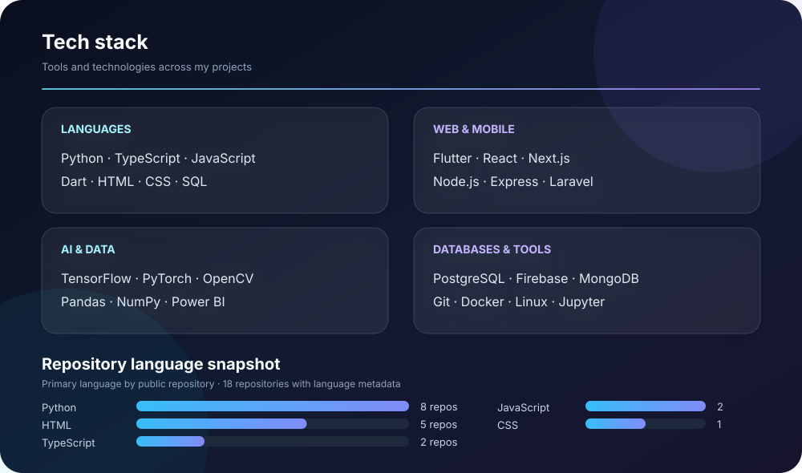

<h1 align="center">Hi, I'm Amaru 👋</h1>

  Computer Science student building practical software with a focus on AI, mobile apps, and data.

  <a href="https://www.linkedin.com/in/paul-kimaru-7810b111b">LinkedIn</a> ·
  <a href="mailto:pmkimaru95@gmail.com">Email</a> ·
  <a href="https://instagram.com/big_amaru">Instagram</a>

## Featured Projects

- **Kenya Vehicle History Verification System** — Flutter app using AI and OCR to verify vehicle history and documents.  
  `Flutter` · `AI/OCR` · `PostgreSQL` · `Node.js`
- **AI Career Path Recommender** — Helps students explore career paths based on their interests, personality, and academic performance.  
  `Flutter` · `Machine Learning` · `PostgreSQL`
- **FundiSwift** — Service marketplace connecting customers with skilled professionals.  
  `Flutter` · `Laravel` · `Firebase` · `Google Maps`
- **MkulimaMdogo** — Smart agriculture platform supporting small-scale farmers with digital tools and AI.  
  `Node.js` · `PostgreSQL` · `AI`

## Tech Stack & GitHub Insights

  

Outside of programming, I enjoy photography, digital art, and 3D design.
